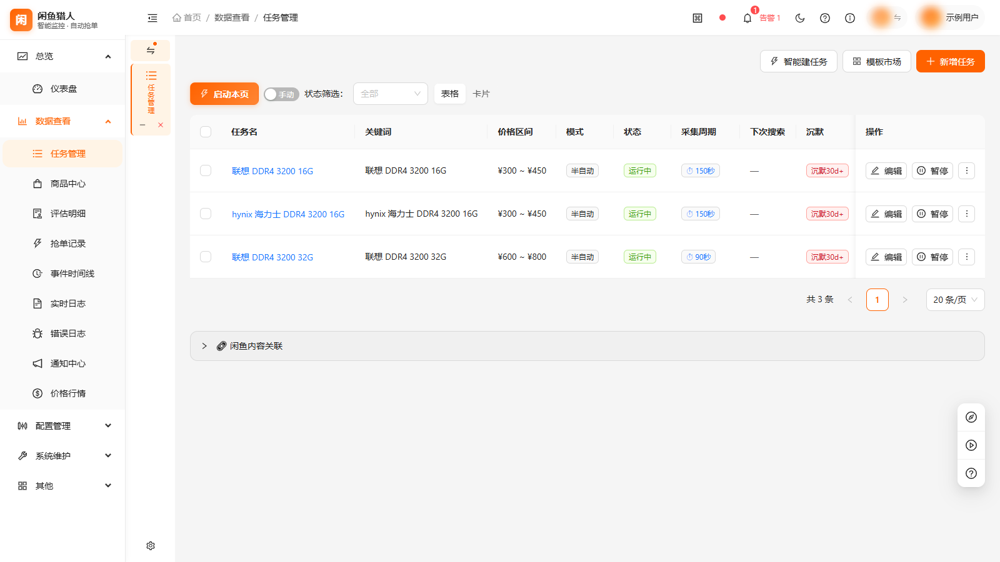
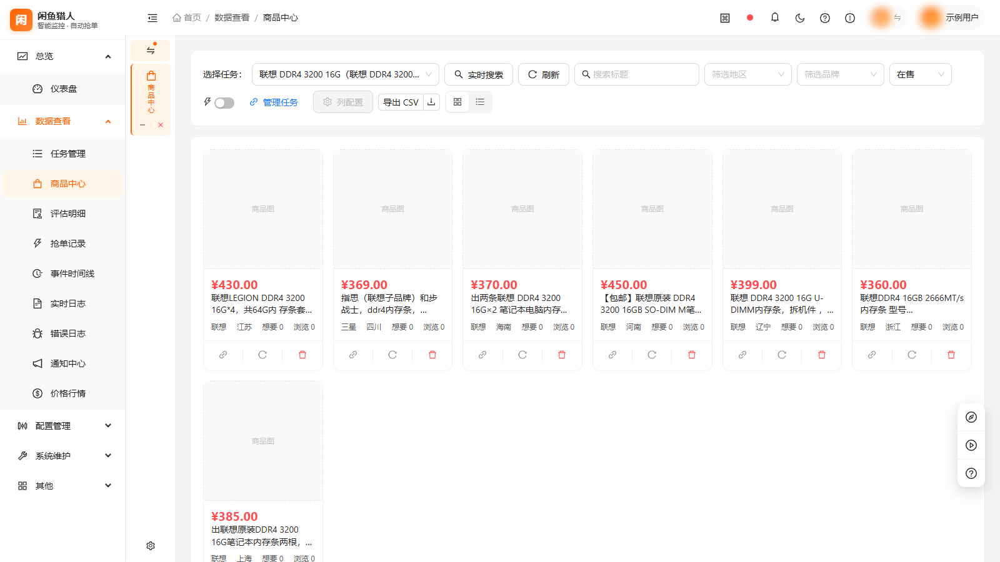
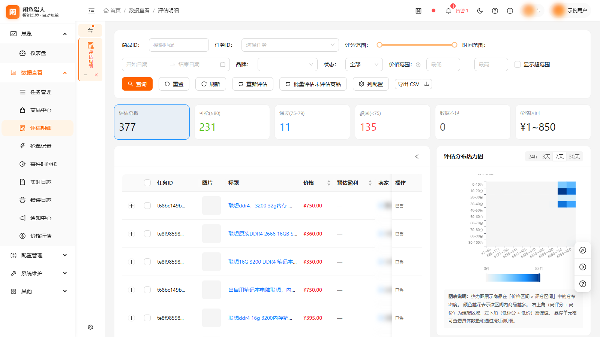
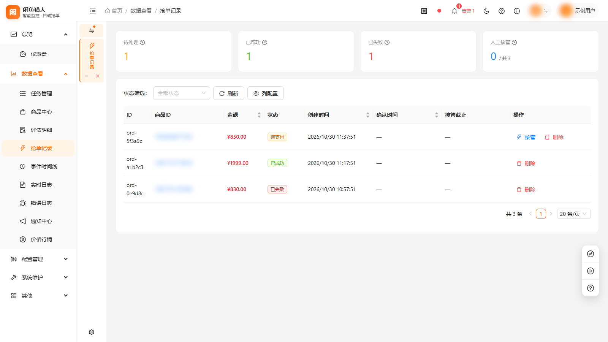
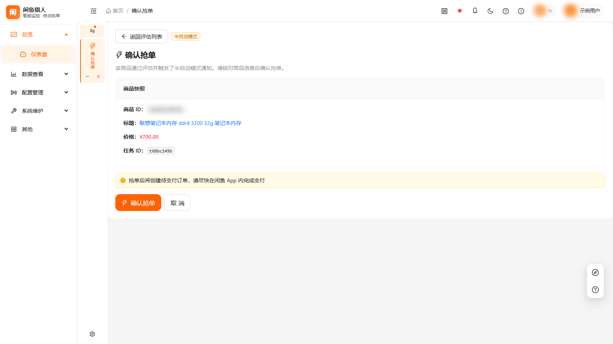
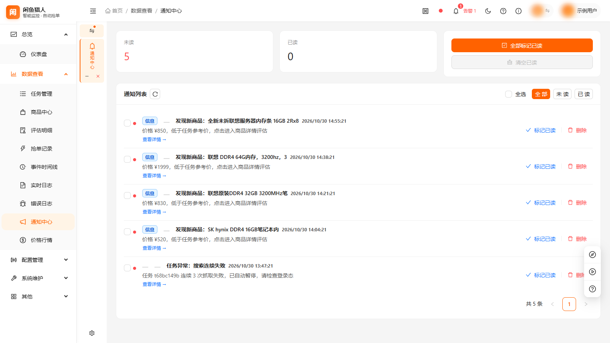
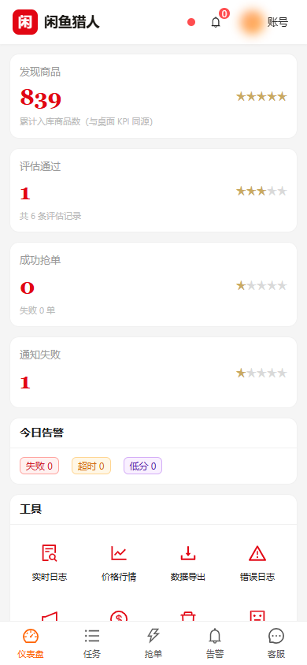
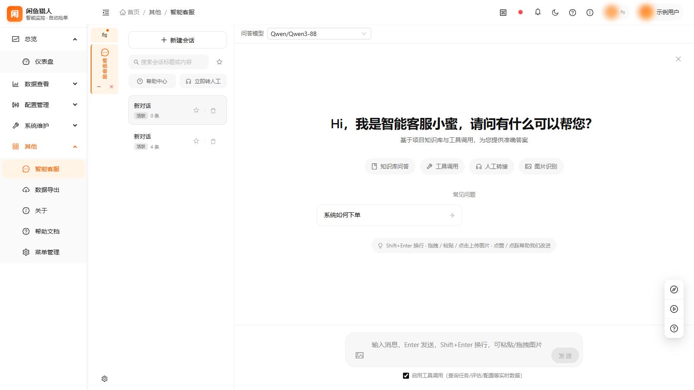

# XianyuHunter


闲鱼（[goofish.com](https://www.goofish.com)）自动捡漏与抢单系统（个人辅助）。

通过浏览器自动化监控关键词商品，经过增量去重与多维卖家评估后，按策略自动下单或推送通知；
配套一套 React 单页控制台（桌面端 + 移动端 PWA），可在浏览器中管理任务、查看商品与订单、
调整配置，并内置基于 RAG 的智能客服。

> ⚠️ **风险免责（必读）**：本工具通过浏览器自动化访问闲鱼，**可能违反平台用户协议并导致账号封禁/限制**。
> 请仅用于个人研究学习，保持低频使用、单一账号、对自己经手的商品负责。
> 开发者不对因使用本工具造成的任何损失（账号封禁、财产损失、纠纷等）承担责任。

## 界面预览

控制台为桌面端 + 移动端两套界面、同一后端。以下截图取自实际运行实例
（示例数据，昵称 / 订单号 / Webhook / 令牌等敏感信息已打码）：

<table>
  <tr>
    <td width="50%"><br><sub>任务管理：关键词、价格区间、执行模式与启停</sub></td>
    <td width="50%"><br><sub>商品库：去重后的候选池，按任务 / 价格 / 时间筛选</sub></td>
  </tr>
  <tr>
    <td width="50%"><br><sub>评估明细：四项评分 + 价格分布热力图</sub></td>
    <td width="50%"><br><sub>抢单记录：订单状态流转与失败原因</sub></td>
  </tr>
  <tr>
    <td width="50%"><br><sub>购买确认：下单前再校验一次价格容差</sub></td>
    <td width="50%"><br><sub>通知中心：告警深链直达商品、订单与任务</sub></td>
  </tr>
  <tr>
    <td width="50%"><br><sub>移动端（可装 PWA）：出门在外也能看任务、收通知、改配置</sub></td>
    <td width="50%"><br><sub>智能客服：本地 RAG 知识库问答</sub></td>
  </tr>
</table>

> 完整配图与逐图说明（含打码要求）见 [`docs/XianyuHunter-产品介绍.docx`](docs/XianyuHunter-产品介绍.docx)。

## 特性

**核心链路**

- 关键词搜索 + 多维价格策略：上限 / 下限（防 1 元引流）/ 市场参考价比例 / 同类低价 TopN，四档可独立开关
- 增量去重（已抓取过的商品不再重复评估）
- 卖方多维评估（职业度 / 信用 / 纠纷 / 价格异动）
- 自动下单，带价格容差校验
- 多任务调度：按 `interval_seconds` 循环，支持 start / pause / resume / stop
- 四种执行模式：`auto` / `semi_auto` / `confirm` / `notify`
- 批量刷新：定时回刷在售商品详情，识别已售状态并补全字段

**风控与稳定性**

- 反爬对抗：QPS 限速、类人操作间隔、浏览器指纹伪装、请求频率伪装、代理池
- 风控（WAF）感知：检测到拦截后主动暂停，避免账号进一步受限
- Cookie 分层轮换与健康管理：登录态自动续期、运行时令牌刷新、健康状态评估
- 风控事件与登录失效均进入事件总线，可在控制台告警并推送

**多账号**

- 多账号管理、账号切换与轮换
- 每账号独立的浏览器档案（profile）与登录态

**通知**

- 八渠道推送：Server酱 / PushPlus / Bark / Telegram / 企业微信 / 钉钉 / 自定义 Webhook / ntfy
- 多渠道并发推送 + 指数退避重试
- 免打扰时段（支持跨午夜、仅推送 critical、仅周末）与按事件类型订阅
- 控制台通知中心 + 告警深链（点击通知直达对应商品 / 订单 / 任务）

**Web 控制台（React SPA，桌面端 + 移动端双套界面，支持 PWA 安装）**

- 桌面端：仪表盘、商品、订单、评估明细、时间线、价格行情、通知中心、日志
- 移动端：独立页面一套（任务、商品、订单、行情、通知、配置、日志等），适配窄屏单手操作
- 任务管理、配置管理、反爬设置、系统维护、菜单管理、导出、帮助、关于
- 实时搜索 / 批量采集（依赖后端浏览器实例）
- 智能客服：RAG 知识库问答（本地向量库 + 中文 Embedding），含意图分类、FAQ 匹配与转人工
- 鉴权：`WEB_TOKEN` 管理令牌 + 多用户会话令牌，数据按用户隔离

**远程访问与交付**

- 内网穿透隧道集成（cloudflared / cpolar），便于外网访问本地控制台
- Windows 桌面打包：PyInstaller 生成单目录 EXE + Inno Setup 安装包 + 系统托盘

## 应用场景

| 场景 | 传统做法 | 用 XianyuHunter |
|------|----------|-----------------|
| 热门机型 / 限量款 | 反复刷搜索页，靠运气碰上 | 关键词 + 价格区间常驻监控，上架即推送 |
| 卖家真假难辨 | 点进主页逐条翻评价与历史 | 四项评分与明细直接给出，低于阈值自动跳过 |
| 价格心里没底 | 跨平台比价、问朋友 | 价格行情与同类低价 TopN，结合市场参考价判断 |
| 上班 / 外出无法盯盘 | 只能事后翻聊天记录 | 手机 PWA 收通知，八渠道任选，随时暂停与恢复 |

## 设计取向

- **本地优先**：商品、卖家、订单、日志都在本机 SQLite，推送密钥由系统 keyring（Windows DPAPI）加密保管，不依赖云端账号
- **开源可审计**：后端 Python + FastAPI，前端 React + TypeScript，浏览器自动化 Playwright，MIT 许可
- **参数可调**：限速、操作间隔、评估阈值、价格策略、通知渠道、免打扰均可调，配置文件与控制台双入口
- **过程可观测**：事件总线解耦「发现 → 评估 → 下单 → 通知」，时间线可回放每一次决策
- **双端一致**：同一套后端同时服务桌面端与移动端，移动端可添加到主屏幕
- **交付省心**：一条脚本完成前端构建、PyInstaller 打包与 Inno Setup 安装包，可选常驻系统托盘

## 技术栈

| 层次 | 技术 |
|------|------|
| 后端 | Python 3.10+ · FastAPI 0.136 · Uvicorn · Typer · Pydantic v2 · SQLAlchemy 2.0 / SQLite · APScheduler · loguru |
| 浏览器自动化 | Playwright 1.60（Chromium） |
| 数据 / 安全 | Keyring（Windows DPAPI）· cryptography（Chrome Cookie 解密）· tenacity（重试） |
| 智能客服 | ChromaDB + sentence-transformers（中文 Embedding：bge-small-zh-v1.5，支持 ONNX 导出） |
| 前端 | React 18.3 · TypeScript 5.5 · Vite 5 · Ant Design 5 · ECharts 5 · Zustand · React Router 6 · PWA |

## 系统要求

| 项目 | 要求 |
|------|------|
| 操作系统 | Windows 10 / 11 64 位（登录态加密依赖 DPAPI；桌面打包同为 Windows） |
| 运行环境 | 源码运行需 Python 3.10+；打包版免安装 Python |
| 磁盘空间 | 建议预留 1 GB 以上（含 Playwright Chromium 与依赖） |
| 网络 | 可正常访问 goofish.com；使用内网穿透时需额外放通隧道端口 |
| 浏览器 | 无需自备浏览器，程序使用内置 Playwright Chromium |

## 安装

```powershell
# 克隆仓库
git clone https://github.com/wangnan05563/xianyu-hunter.git
cd xianyu-hunter

# 创建并激活虚拟环境
python -m venv .venv
.\.venv\Scripts\Activate.ps1

# 安装依赖
pip install -r requirements.txt

# 安装 Playwright Chromium
playwright install chromium
```

前端（仅在需要自行构建控制台界面时）：

```powershell
cd frontend
npm install
npm run build
```

## 快速开始

### 1. 初始化配置

`config/config.yaml` 含本地凭据、不纳入版本控制，首次使用从模板复制：

```powershell
copy config\config.example.yaml config\config.yaml
```

推送 Key 不进入版本库：可在 Web 控制台设置页保存到本机 `config/config.yaml`
（该文件已 gitignore），也可写入 `.env`。敏感字段在运行时优先取系统 keyring
（Windows DPAPI）中的加密副本，keyring 不可用时降级到 `data/.secrets.json`。

```powershell
copy .env.example .env
# 按需填写 SERVERCHAN_KEY / PUSHPLUS_TOKEN / BARK_KEY 等
```

> 💡 首次启动若缺少 `WEB_TOKEN`，程序会自动生成并写入 `.env`。

### 2. 编辑配置

`config/config.yaml` 是主配置（运行时也可在 Web 控制台修改）：

```yaml
antidetect:
  qps: 6                  # 限速：每秒最多 6 个请求
  min_delay_ms: 10000     # 页面操作最小间隔
  max_delay_ms: 15000
  fail_pause_threshold: 3 # 连续失败 N 次暂停
  fail_window_sec: 3600

notifier:
  default_channels: [serverchan]
  channels:
    serverchan: true
    pushplus: false
    bark: false
  quiet_hours:
    enabled: false
    start: '23:00'
    end: 07:00

price_strategy:
  enabled_max: true
  max_price: 800
  enabled_min: true
  min_price: 100
  enabled_market_ratio: true
  market_ratio: 0.8
  enabled_top_n: true
  top_n: 5
```

`config/eval.yaml` 控制卖家评估阈值与权重。

> ⚠️ 限速与间隔默认值偏保守，请勿为了"抢得快"下调，这是账号安全的主要闸门。

### 3. 首次登录

首次使用需登录闲鱼，登录态持久化到 `data/browser-data/`（打包版为
`%APPDATA%\XianyuHunter\browser-data\`），下次启动自动恢复。

```powershell
python -m xianyu_hunter login
# 弹出 Chromium，手动扫码登录
```

### 4. CLI 命令

```powershell
# 新增监控任务
python -m xianyu_hunter add --keyword "iPhone 13" --min-price 1500 --max-price 2500 --mode auto

# 列出所有任务
python -m xianyu_hunter list

# 启动调度器（启动所有 RUNNING 任务）
python -m xianyu_hunter run

# 启动单个任务
python -m xianyu_hunter run t1

# 任务控制
python -m xianyu_hunter pause t1
python -m xianyu_hunter resume t1
python -m xianyu_hunter stop t1

# 查看任务状态
python -m xianyu_hunter status            # 全部
python -m xianyu_hunter status t1         # 单个

# 查看当前配置
python -m xianyu_hunter config-show
```

执行模式（`--mode`）：

| 模式 | 行为 |
|------|------|
| `auto` | 评估通过 → 立即自动抢单 |
| `semi_auto` | 评估通过 → 推送通知 → 人工确认后下单 |
| `confirm` | 评估通过 → 推送通知 → 不自动抢单（保守） |
| `notify` | 仅推送，不评估、不抢单（默认） |

### 5. 启动 Web 控制台

```powershell
# 方式一：项目自带脚本（Web + 调度器，含浏览器实例）
scripts\启动服务.bat

# 方式二：直接调用 CLI
python -m xianyu_hunter web
```

启动后访问：

- 控制台：`http://127.0.0.1:8001/xianyu`
- API 文档：`http://127.0.0.1:8001/api/docs`

`web` 常用参数：`--host`（默认 `127.0.0.1`）、`--port`（默认 `8001`）、
`--reload`（开发模式热重载）、`--with-scheduler`、`--workers`。

> ⚠️ 控制台入口固定为 `/xianyu` 子路径。直接访问 `/` 会返回页面但路由无法匹配，导致空白页。

## 配置

| 文件 | 说明 |
|------|------|
| `config/config.yaml` | 主配置（反爬限速 / 推送渠道 / 价格策略 / 免打扰等），本地副本、gitignore |
| `config/eval.yaml` | 卖家评估阈值与权重 |
| `config/menu_registry.yaml` | 控制台菜单注册表 |
| `config/param_rules.yaml` | 参数校验规则 |
| `config/*.example.yaml` | 配置模板（供新部署参考） |
| `.env` | 环境变量（推送 Key、`WEB_TOKEN`、日志级别等，从 `.env.example` 复制） |

## 架构

```
CLI / Web (FastAPI)
   └─→ Container (DI)
        ├─ BrowserManager          ← Playwright + stealth
        ├─ AntiDetect              ← QPS + 类人行为 + 指纹/频率伪装 + 代理池
        ├─ Repository              ← SQLite
        ├─ EventBus                ← asyncio.Queue
        ├─ Collector               ← 搜索 / 详情 / 卖家
        ├─ Dedup                   ← 增量去重
        ├─ PriceStrategy           ← 多维价格过滤
        ├─ Evaluator               ← 多维评估
        ├─ Buyer                   ← 自动下单
        ├─ NotifierHub             ← 多渠道推送
        ├─ CookieRotator           ← 登录态分层轮换 / 健康管理
        ├─ AccountRotator          ← 多账号轮换
        ├─ Chatbot                 ← 知识库问答（RAG）
        ├─ TunnelService           ← 内网穿透（cloudflared / cpolar）
        └─ TaskScheduler           ← 多任务调度
             └─ TaskWorker (one per Task)
```

数据流：`搜索 → 去重 → 详情 → 价格 → 评估 → 下单 / 通知`。

事件由 `EventBus` 解耦：Buyer 发布 `BUY_SUCCEEDED`，NotifierHub 订阅并按「事件订阅 + 免打扰」
决定是否推送。

## 目录结构

```
17_xianyu/
├── backend/xianyu_hunter/      # Python 后端源码（主包）
│   ├── domain/                 # 领域模型（item / order / seller / task / events）
│   ├── infra/                  # 基础设施（db / browser / logger / secrets / repository）
│   ├── modules/                # 业务模块（collector / evaluator / buyer / notifier /
│   │                           #   scheduler / anti_detect / cookie_rotator / chatbot / …）
│   ├── web/                    # FastAPI Web 层（routes / services / static）
│   ├── __main__.py             # CLI 入口（typer）
│   ├── config.py               # 配置加载（pydantic-settings）
│   └── container.py            # 依赖注入容器
├── frontend/                   # React + TypeScript 前端（Vite）
│   ├── src/pages/              # 桌面端页面
│   ├── src/mobile/             # 移动端页面与布局
│   └── public/                 # 静态资源与 PWA 图标
├── config/                     # 配置文件（config / eval / menu_registry / param_rules）
├── tests/                      # 后端测试（pytest）
├── scripts/                    # 启动 / 构建 / 部署 / 发布脚本（.bat / .ps1 / .py）
├── docs/                       # 项目文档（需求 / 设计 / 迭代记录 / 维护报告）
├── assets/                     # 品牌资源（应用图标 / GitHub 社交预览图）
├── data/                       # 运行时数据（SQLite / 浏览器档案 / 日志，gitignore）
├── pyproject.toml              # Python 项目配置
├── requirements.txt            # Python 依赖（锁定版本）
└── installer.iss               # Inno Setup 安装包脚本
```

## 测试

后端：

```powershell
$env:PYTHONPATH = "backend"
python -m pytest tests/ -v
```

当前后端测试：**2249 passed, 3 skipped**（共 2252 个用例，含覆盖率统计）。

前端：

```powershell
cd frontend
npm run test      # vitest run
```

当前前端测试：**1183 passed**（137 个测试文件）。低配机器上默认 5s 单测超时预算可能触发
少数用例超时（无断言失败），可放宽：

```powershell
npx vitest run --testTimeout=30000
```

## 数据与日志

开发模式数据落在仓库内 `data/`，PyInstaller 打包后落在 `%APPDATA%\XianyuHunter\`：

| 路径 | 说明 |
|------|------|
| `data/xianyu.db` | SQLite（任务 / 商品 / 卖家 / 评估 / 订单 / 事件 / 通知） |
| `data/browser-data/` | 浏览器 user data dir（登录态） |
| `data/logs/*.log` | loguru 滚动日志 |
| `data/screenshots/` | 失败截图（如有） |

## 桌面应用打包

```powershell
# 前端构建 → PyInstaller 打包 → Inno Setup 安装包
scripts\构建打包.bat
```

产物为 Windows 单目录 EXE（`release/xianyu-hunter/`）与 Inno Setup 安装包。
安装包可选启用系统托盘（依赖 `pystray` + `pillow`）。

## 常见问题

**需要电脑一直开着吗？**

需要。程序在本机运行，电脑休眠或断网时监控会停止；移动端用于远程查看与操作控制台。

**会不会导致账号被限制？**

存在风险，见 [风险与免责](#风险与免责)。默认参数低频保守，检测到风控会主动暂停；建议单账号、低频率使用。

**抢单一定能成功吗？**

不保证。详情页「立即购买」的窗口通常不足 30 秒，对网络与响应延迟敏感；建议先用 `confirm` 或 `semi_auto` 模式观察。

**推送渠道怎么选？**

国内手机推荐 Server酱、PushPlus 或 Bark；团队协作可用企业微信、钉钉或自定义 Webhook；自建服务可选 ntfy。

**数据会被上传吗？**

不会。商品、订单、日志保存在本地数据库，密钥保存在系统 keyring，不经过任何第三方服务器。

**智能客服需要联网吗？**

知识库与向量检索在本机完成；接入在线大模型时按你配置的服务商调用，关闭 AI 总开关即完全走本地规则。

## 已知限制

1. **不支持云控验证码**：首次登录需人工；运行时若触发滑块会失败，并由风控模块暂停
2. **抢单窗口短**：详情页"立即购买"按钮从出现到消失通常 < 30 秒，对网络延迟敏感
3. **选择器需维护**：闲鱼侧风控更新后部分选择器可能失效，需更新 `infra/selectors.py`
4. **平台为 Windows**：登录态加密（DPAPI）、启动脚本与安装包均面向 Windows

## 风险与免责

1. **违反平台 ToS 风险**：本工具不伪装身份，但自动化访问行为可能违反闲鱼《用户协议》
2. **账号封禁风险**：高频访问 / 重复操作可能被识别并导致账号功能受限或封禁
3. **风控升级风险**：闲鱼侧持续更新反爬策略，本工具可能随时失效
4. **财产风险**：抢单虽设价格容差校验，仍可能因页面 / 网络延迟导致错价，作者不对任何交易结果负责
5. **数据合规**：本工具仅在本地运行，不上传任何数据到第三方

**使用本工具即视为同意**：仅限个人学习 / 研究使用，自担一切风险。

## 贡献

欢迎在 [Issues](https://github.com/wangnan05563/xianyu-hunter/issues) 反馈问题、提交 Pull Request。提交前请确保：

1. 后端测试通过：`python -m pytest tests/`
2. 前端测试通过：`cd frontend && npm run test`
3. 前端类型检查与构建无错误：`cd frontend && npm run build`

如果你也在二手平台蹲过心仪的东西，欢迎 Star 与提 Issue，一起把「捡漏」这件事做得更省心。

## 许可证

[MIT](LICENSE)

## 致谢

感谢 [Playwright](https://playwright.dev/)、[FastAPI](https://fastapi.tiangolo.com/)、
[React](https://react.dev/)、[Ant Design](https://ant.design/)、
[ChromaDB](https://www.trychroma.com/) 等开源项目。
